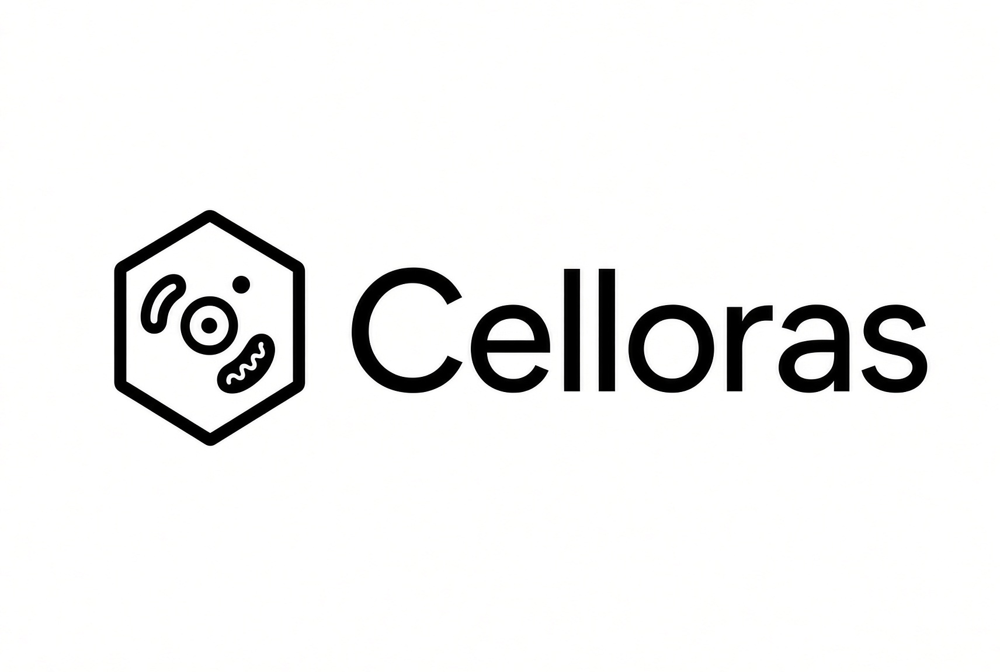
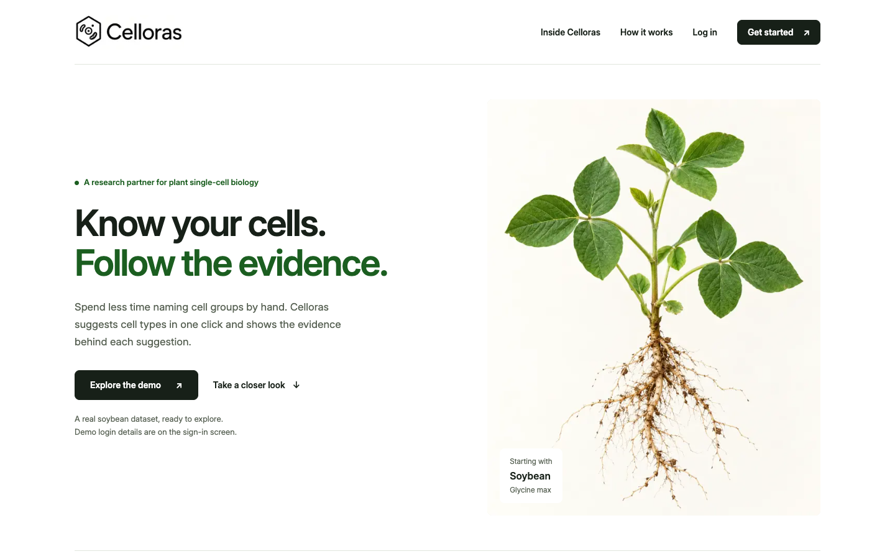
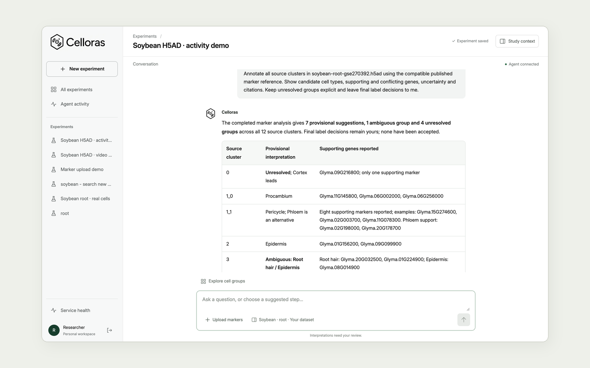
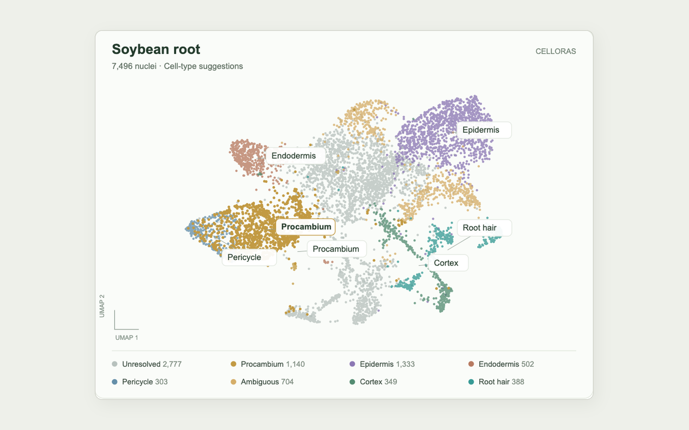
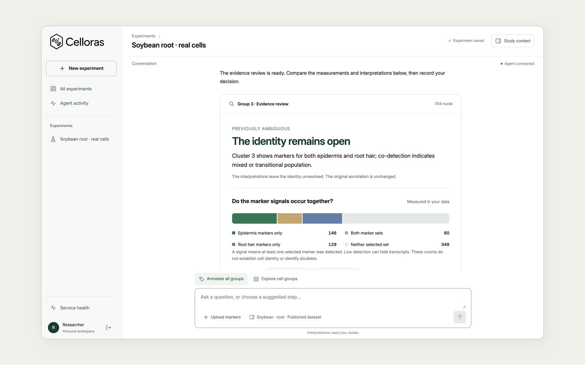
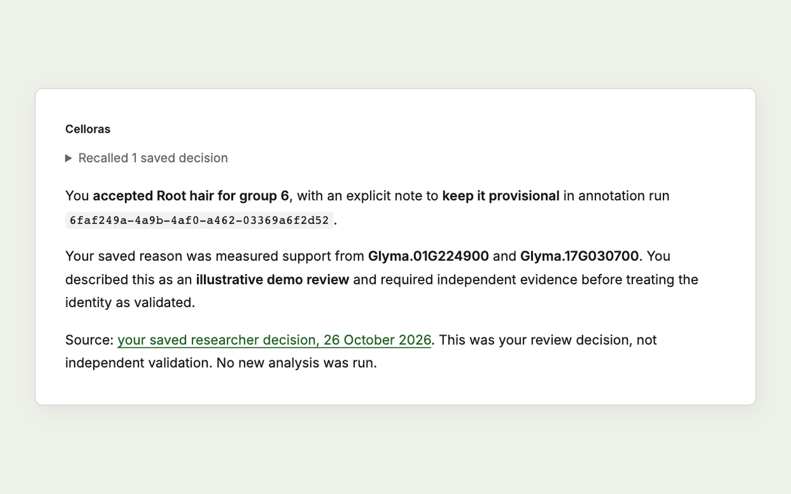
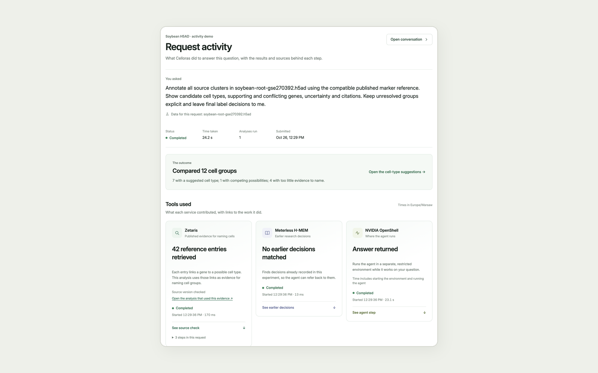

# Celloras

<p align="center">
  
</p>

Celloras helps plant researchers name the cell groups in their single-cell data, with evidence. Upload a dataset, and an agent maps the cells, suggests cell types from measured expression and published markers, and remembers each decision the researcher makes. Soybean comes first.

**[Live app](https://celloras.com) · [Video](https://www.youtube.com/watch?v=9Q0m_sJrHcY) · [Pitch deck](https://celloras.com/deck/Celloras-Pitch.pdf) · [How it works](https://celloras.com/technical-flow.html)**

## Screens

<table>
<tr>
<td width="50%"><br /><b>Start:</b> open the demo or bring your own dataset.</td>
<td width="50%"><br /><b>Chat:</b> ask in plain words; the agent answers with a cell-type table and the genes behind it.</td>
</tr>
<tr>
<td width="50%"><br /><b>Annotate:</b> 7,496 soybean root cells, with a suggested cell type per group.</td>
<td width="50%"><br /><b>Investigate:</b> Nightshift on NVIDIA Nemotron compares epidermis and root hair using measured co-detection.</td>
</tr>
<tr>
<td width="50%"><br /><b>Recall:</b> H-MEM brings back the researcher's earlier decision with its source.</td>
<td width="50%"><br /><b>Agent activity:</b> what the agent did, the outcome and each sponsor tool's part.</td>
</tr>
</table>

## What it does

1. **Upload** an `.h5ad` dataset (up to 4 GiB) or a marker CSV. Use the built-in soybean root example if you have none.
2. **Explore** the cell map, gene expression and dot plots for any group.
3. **Annotate**: the agent suggests a cell type per group, shows supporting and contrary evidence, and says "unresolved" when the evidence is weak.
4. **Investigate** an unclear group: a deeper comparison of competing cell types.
5. **Decide and recall**: accept, correct or reject each suggestion with a reason. Celloras recalls those decisions in later conversations.

## Sample inputs and outputs

Real requests on the live app, using the soybean root dataset (7,496 cells, 12 groups). Sign in to open a saved request.

| Input                                                         | Output                                                                                                                                                                                                   |
| ------------------------------------------------------------- | -------------------------------------------------------------------------------------------------------------------------------------------------------------------------------------------------------- |
| **Annotate all groups** after importing the root H5AD         | Map of all 7,496 cells. 7 groups suggested, 1 ambiguous, 4 unresolved. Zetaris supplied 42 published marker associations. [Open](https://celloras.com/app/activity/3ff0f30e-3655-4e83-8b4e-08f703054b46) |
| Compare `Glyma.01G224900` and `Glyma.17G030700` across groups | Measured two-gene dot plot. Group 6 is a provisional root hair candidate. [Open](https://celloras.com/app/activity/a478d8b2-4094-499e-a524-fe68af2e6b21)                                                 |
| "What did we decide for group 6?" after saving a review       | H-MEM recalls the saved review and links its source. The annotation itself is unchanged. [Open](https://celloras.com/app/activity/ee487b10-71e8-45c7-82d0-c857bc47588f)                                  |
| **Investigate this group** on group 3                         | Nightshift (NVIDIA Nemotron) compares the competing cell types using measured marker co-detection. Completed 3 times on 27 October.                                                                      |

## How we use the sponsor technology

| Technology                                 | Role in Celloras                                                                                                                                                                                                                                                                                                                                                                            | Proof it works                                                                                                                                                                               |
| ------------------------------------------ | ------------------------------------------------------------------------------------------------------------------------------------------------------------------------------------------------------------------------------------------------------------------------------------------------------------------------------------------------------------------------------------------- | -------------------------------------------------------------------------------------------------------------------------------------------------------------------------------------------- |
| **Zetaris**                                | The annotation tool queries a versioned soybean marker table (42 associations, 41 genes, 9 cell types) through Zetaris's SQL API with a read-only account. It checks the table's content hash and shows the query receipt on every annotation. If access fails or the content changes, the run stops instead of falling back to a local copy. [Adapter](app/adapters/zetaris-reference.mjs) | All 9 Zetaris checks passed. A live annotation retrieved all 42 associations with query receipt ([request](https://celloras.com/app/activity/3ff0f30e-3655-4e83-8b4e-08f703054b46)).         |
| **Meterless H-MEM Engine**                 | Meterless's official H-MEM reference ([vendored with license](third_party/meterless-hmem/README.md)) runs in the worker. It stores each researcher's saved reviews per project and recalls the relevant ones, with sources, when a new question starts. A correction replaces only the review it targets. [Adapter](app/adapters/research-memory.mjs)                                       | All 13 upstream conformance checks passed. Live recall found a saved review past 31 newer notes. Example: [request](https://celloras.com/app/activity/ee487b10-71e8-45c7-82d0-c857bc47588f). |
| **Meterless Nightshift + NVIDIA Nemotron** | **Investigate this group** sends measured marker co-detection for an unclear group to Nightshift, which runs NVIDIA Nemotron 3 Ultra (`nemotron-3-ultra-550b-a55b`) to compare the competing cell types. The researcher still makes the final call. [Gateway](app/gateway/nightshift-investigation.mjs) · [Server setup](infra/nightshift/)                                                 | 3 investigations of group 3 completed on the live app on 27 October ([receipt](docs/evidence/nightshift-investigations-2026-10-27.json)).                                                    |
| **NVIDIA OpenShell**                       | The chat agent (Codex CLI) runs inside an OpenShell sandbox on our Linux server.                                                                                                                                                                                                                                                                                                            | Real model turns verified on the production server.                                                                                                                                          |

**What's unique:** published evidence (Zetaris), measured data and each researcher's own decisions (H-MEM) are kept apart. A remembered opinion can never pass as published evidence, and every step is visible in **Agent activity**. Development used Codex; Cursor was not used.

## Data and method

| Data                                                        | Source                                                                                                                                                                                                             |
| ----------------------------------------------------------- | ------------------------------------------------------------------------------------------------------------------------------------------------------------------------------------------------------------------ |
| Soybean root counts, 7,496 nuclei × 40,127 genes, 12 groups | [GSE270392](https://www.ncbi.nlm.nih.gov/geo/query/acc.cgi?acc=GSE270392) (Zhang et al., _Cell_ 2025). The 29 MB demo H5AD is our lossless conversion of the published RDS: raw counts, groups and UMAP unchanged. |
| Root marker panel: 42 associations, 41 genes, 9 cell types  | Table S2 of the same paper (Wm82v4 gene IDs), served through Zetaris.                                                                                                                                              |
| Literature: 3 papers                                        | Short factual summaries only, as their licenses allow.                                                                                                                                                             |

**Method:** for each group, the engine compares measured expression of the panel's marker genes with the rest of the cells. It suggests a cell type only when fixed evidence rules are met, shows supporting and contrary genes, and otherwise says "unresolved". Species, tissue and genome build must match exactly. Suggestions are not validated identities and need researcher review. Large source files stay out of Git.

## How it works

Next.js app (UI and API) → PostgreSQL (projects, reviews, agent queue) → worker. The worker runs the Codex agent in an NVIDIA OpenShell sandbox together with Celloras's tools: dataset analysis, Zetaris marker lookup, H-MEM recall and Nightshift investigation. Keycloak handles login. Every request checks project ownership before touching data.

## Setup

**Dependencies:** Node 22.22.0 (`.nvmrc`) and npm, Docker Compose 28+, Codex CLI. Libraries are pinned in [package.json](package.json). Compose pins PostgreSQL, Keycloak, OpenShell and the Python H5AD importer.

```sh
git clone https://github.com/mpckkk/2026_GenAI.git
cd 2026_GenAI
npm ci
npm run setup                 # creates .env with generated secrets
docker compose up -d --build h5ad-importer app
```

Open [localhost:3100](http://localhost:3100) and register an account.

**Agent:**

```sh
codex login
npm run agent:setup
npm run agent:verify          # makes one real model call
docker compose up -d --build agent-worker app
```

**Soybean root data:**

```sh
mkdir -p .artifacts/datasets/GSE270392
curl -fL -o .artifacts/datasets/GSE270392/GSE270392_Gm_atlas_Root.rna.seurat.obj.rds.gz \
  https://ftp.ncbi.nlm.nih.gov/geo/series/GSE270nnn/GSE270392/suppl/GSE270392_Gm_atlas_Root.rna.seurat.obj.rds.gz
npm run data:import           # checks the file's checksum, then converts it
```

**Sponsor services** (set in `.env`, never in Git):

| Service    | Settings                                                                                                                                                                                           | Check                                                         |
| ---------- | -------------------------------------------------------------------------------------------------------------------------------------------------------------------------------------------------- | ------------------------------------------------------------- |
| Zetaris    | `ZETARIS_API_URL`, `ZETARIS_API_TOKEN`, `ZETARIS_ORG_ID`, `ZETARIS_REFERENCE_TABLE`, then `CELLORAS_REFERENCE_PROVIDER=zetaris`. Load the table from `node scripts/prepare-zetaris-reference.mjs`. | `node --env-file=.env scripts/verify-sponsors.mjs zetaris`    |
| H-MEM      | none, bundled in the worker                                                                                                                                                                        | runs with the agent                                           |
| Nightshift | `NIGHTSHIFT_API_URL`, `NIGHTSHIFT_API_TOKEN`, `NIGHTSHIFT_MODEL`, then `CELLORAS_INVESTIGATION_ENABLED=true`. Server image in `infra/nightshift/`.                                                 | `node --env-file=.env scripts/verify-sponsors.mjs nightshift` |

**Checks:** `npm run lint`, `npm run typecheck`, `npm run build`, `npm run test:e2e`.

## Usage

1. Sign in, then choose **Add dataset** and upload an `.h5ad` file, or **Download soybean root** for the example.
2. Pick the raw count matrix, gene IDs, cell groups and UMAP, then confirm tissue and genome build.
3. Open the experiment and choose **Annotate all groups**.
4. Open a group's evidence, then accept, correct, reject or leave it unresolved with your reason. Use **Investigate this group** for unclear ones.
5. Ask follow-up questions in chat. **Agent activity** in the sidebar shows every step the agent took.

**Marker CSV** (**Upload markers** in an experiment): one gene per row with a group column, up to 4,000 rows and 20 groups. [Example file](public/examples/soybean-root-markers.csv).

```csv
cluster,gene,tissue,genome_version
Group A,Glyma.01G224900,root,Wm82v4
```

The first implementation commit is `694d1a8` (23 October 2026). The public deployment runs on Dokploy from `main` with `compose.yaml` + `compose.prod.yaml`, and each push deploys automatically.
