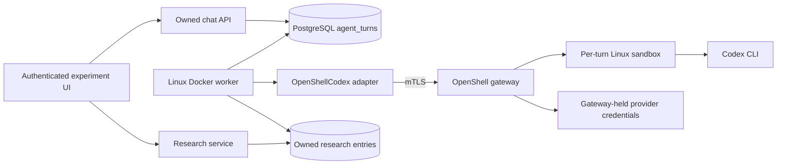

# Celloras architecture

Celloras separates the research domain, durable conversation queue and execution runtime. Soybean is the first configured plant; species-specific data does not define the database schema or UI contracts.

## Conversation and execution

`app/core/chat.ts` defines `ChatTurn`, `ChatWorkspace` and `ChatRepository`. `ChatService` validates input and ownership; `PostgresChat` independently enforces ownership and serializes admission on the project row. `GET/POST/DELETE /api/projects/:projectId/chat` load history, submit a prompt and request cancellation. Writes check authentication, origin and ownership before reading a bounded JSON body. Browser input cannot choose the runtime, provider, model or sandbox.

The append-only submission identity is `(project_id, submission_id)`. Identical prompts replay their original turn even when the worker is offline; changed prompts conflict. A partial unique index permits one queued/running turn per experiment. Admission checks active turns and terminal turns awaiting sandbox cleanup in one SQL snapshot. New turns also require a ready worker heartbeat newer than 30 seconds. History uses bigint string cursors and returns at most 50 turns in chronological order.

`infra/agent/worker.mjs` claims queued rows with `FOR UPDATE SKIP LOCKED`. It freezes bounded completed chat history, recent owned research entries and the independently queried latest sample context. Context is retained even when more than 30 subsequent research records exist. Missing or truncated history is disclosed to the agent as unknown; saved research content is treated as data, not trusted instructions.

`app/adapters/agent-openshell.mjs` is the execution adapter. Its current `OpenShellCodex` implementation creates a per-turn sandbox, executes the pinned Codex CLI and accepts a response only after a completed turn event. `run-codex.mjs` disables shell, browser, external app and other tool capabilities for this conversational increment. Scientific tools are brokered through the typed response protocol: published root/nodule marker lookup, real sparse root analysis, provisional annotation and curated literature retrieval. Complete atlas coverage and independently validated annotation remain pending.

The worker records real progress and terminal state. Queued cancellation is immediate; running cancellation signals the adapter and removes the exact turn sandbox. Interrupted execution becomes an explicit failure, without automatically repeating the model call. Cleanup is retried separately, and an experiment stays blocked until outstanding sandbox deletion is confirmed. `CELLORAS_AGENT_RUNTIME=nightshift` selects the separate Meterless API adapter using the same independently authorized tool broker and strict card parser. It creates no sandbox; historical OpenShell cleanup always uses the OpenShell adapter. Nightshift live acceptance still needs runtime access. Alternative CLIs, direct APIs, OpenRouter and Vercel routes are not currently verified chat adapters.

Explicit saved reviews also feed `ResearchMemory` during the owned turn-claim transaction. The pinned Meterless H-MEM reference ranks only the current decisions for exact review targets. PostgreSQL holds per-project state and an append-only trust ledger; retrieved source receipts are frozen in the turn and expandable in the UI. Other projects cannot enter the engine's candidate set. Automatic biological mining, semantic conflict resolution, sleep and dreaming are disabled. See [sponsor setup and limits](configuration.md#sponsor-integrations).

## Visual response contract

`app/core/agent-response.schema.json` defines v1 model output: an ordered list of Markdown blocks and `sample_context`, `marker_set`, `marker_evidence`, `scientific_result`, `literature_result` and `annotation_result` references, plus explicit `lookup_marker_evidence` and `run_scientific_tool` requests. `agent-response.d.mts` supplies provider-neutral types; `agent-response.mjs` strictly checks object keys, versions, supported types, UUIDs, duplicate references, block count and text limits. The first runtime uses Codex's [schema-constrained output](https://learn.chatgpt.com/docs/non-interactive-mode); future CLI/API adapters return the same `AgentResponse` contract.

The worker includes exact IDs in bounded research context and offers an explicit card catalog. Models select only a type and entry ID. `app/services/agent-response.mjs` checks that selection against the catalog and independently queries canonical research rows with project, author and owner predicates. Wrong-kind, absent, foreign-project and foreign-owner references fail with `agent_card_unavailable`; malformed output fails with `agent_response_invalid`. No partial card output or invented data is substituted.

Resolved `ResponseDocument` blocks contain saved research snapshots and source metadata. The terminal worker update commits the document and its Markdown text projection atomically; cancellation and failure store neither. Migration 004 adds nullable `response_document`, preserving old replies. Existing null-document rows use their original Markdown; new documents use the finite component registry in `agent-response.tsx`. The text projection keeps older readers usable.

Cards reuse the research components and configured plant catalog. Compact sample fields and expandable metadata, marker chips/original input and source details are predefined React UI. Card follow-up actions append an editable question to the composer without sending or discarding existing text; actions are disabled during an uncertain submission. Research content remains researcher-authored and unverified. The bounded catalog includes recent records and the latest sample, not every historical record. Evidence, numerical plots and provisional annotation cards resolve persisted canonical tool results.

Workload revision `celloras-codex:0.163.0-annotation1` includes the current canonical schema. Upgrade the workload and worker together after migration; the adapter rejects old free-text output. Stop the worker before changing its image. Preserve additive tables and columns on rollback; after new result types exist, roll forward with a renderer that understands them.

## Published marker evidence and review

`MarkerEvidenceSource` is the provider-neutral contract. The worker composition root injects `PublishedMarkerReference` into `runMarkerEvidence`; the adapter loads a versioned factual reference asset. The app checks the same asset in readiness. [Reference documentation](soybean-reference.md) gives coverage, provenance, matching rules and validation limits.

A model can request one `lookup_marker_evidence` operation for an offered saved marker ID. The worker checks the offered catalog and independently joins project ownership, researcher authorship and the active owned turn before looking up anything. The tool uses the marker's immutable attached context. It stores the canonical input and result in `marker_evidence_runs`, then invokes the runtime again with the actual result. A second tool request fails with `agent_tool_limit`. The final reply always includes the completed lookup's inspectable evidence card. Each inference execution removes its turn sandbox before another execution starts; heartbeats/cancellation continue across the entire turn.

Tool start/completion logs contain turn/run IDs, status and candidate counts, not genes, notes or provider credentials. A source failure is explicit. Completed lookup snapshots can remain as audits for failed/cancelled turns, but reviews require a completed owned originating turn. No interrupted inference is automatically replayed.

Migration 005 adds evidence runs and an `evidence_review` research kind with same-project references. `PostgresResearch` revalidates ownership, completion, marker linkage and returned candidate names inside the append transaction. The browser cannot supply the evidence snapshot; the repository copies it from the run. Existing submission idempotency/conflict handling applies. Reviews retain the exact input, source version/hash and result. Chat history returns latest review receipts for the evidence cards on that page, independently of research-history pagination. Review links reopen the cited chat position, including older evidence turns.

Prior text and sample/marker documents remain readable. Migration 005 introduced evidence review; current deployments also require migrations 006 and 007 and the matching annotation workload. After evidence reviews exist, roll forward rather than booting an older app that cannot render the new research kind. Do not remove the additive tables/columns to undo a deployment.

## Runtime and credential boundary

The application and worker are Linux Docker images. The worker reaches the OpenShell gateway using its own mTLS client configuration. The default gateway uses Docker; an explicit Apple Silicon helper can run the gateway outside Compose with the Linux MicroVM driver. The Mac launcher is not an application dependency for Linux deployment. Both use the same agent image and execution adapter.

`agent:setup` imports the operator's access token and account ID into the gateway through a child process environment. It leaves the host login file untouched and does not import its refresh token. The worker receives only account ID/expiry metadata for the provider; current Codex workspace discovery requires the actual account ID. Inside the sandbox, the bearer credential remains an opaque OpenShell provider handle. The browser never receives provider credentials.

OpenShell v0.1.5 and Codex CLI 0.163.0 are pinned. A real direct response has been verified in a Linux MicroVM on Mac. Native Linux and complete browser acceptance are tracked in [verification](verification.md); implementation alone is not proof of those deployment paths. [Configuration](configuration.md) describes setup, credential renewal and state ownership.

## Structured research

Each owned project is shown as an experiment. Existing project IDs and APIs remain compatible. `ResearchCommand` is a discriminated union of researcher messages, plant/sample contexts, marker submissions, manual reviews and evidence-linked reviews. Fixed React components render those records. Agent replies use Markdown and finite predefined cards; arbitrary generated UI is not executed.

`ResearchService` validates plant context through `PlantCatalog`, tokenizes markers without changing original text/case and resolves references. `PostgresResearch` checks ownership, locks the project, validates submission fingerprints and expected reference kinds, then commits. Identical retries return the original entry; changed content conflicts. Same-project foreign keys prevent cross-experiment references.

`research_entries` uses keyset pagination and bigint string positions. Each marker set retains the snapshot of its referenced context; updating the current sample never rewrites prior markers. Manual reviews reference saved marker entries and remain researcher-authored, unverified interpretations. Commit results determine save receipts, and drafts survive validation or uncertain transport failures.

`app/plant-catalog.ts` provides reviewed species configuration through `ConfiguredPlantCatalog`; soybean is initially enabled. Tissue labels are suggestions. Adding another species requires appropriate references, mappings and evaluation as well as configuration. Catalog registration does not enable annotation or cross-species transfer.

## Identity and ownership

Keycloak owns registration and credentials. `KeycloakAuth` uses `openid-client` with authorization-code exchange, PKCE, state, nonce, issuer and audience validation. Short-lived OAuth transactions live in PostgreSQL. Verified issuer/subject pairs identify application users; an HttpOnly session cookie contains an opaque handle whose hash selects the server-side session. Provider identity tokens are retained only for logout, never exposed in browser storage or model context.

Sessions expire after one hour. Logout is an origin-checked POST that revokes the application session and ends the Keycloak session. Every project/research/chat server boundary derives the user from that session. SQL includes owner predicates; foreign and absent projects both return 404.

Local browser issuer URLs use `localhost:8180`; the app rewrites only transport to the internal Keycloak service while preserving canonical issuer validation. Production configuration requires HTTPS and explicit deployment overrides.

## Integration ledger

| Boundary               | Implemented                                                                 | Remaining                                                             |
| ---------------------- | --------------------------------------------------------------------------- | --------------------------------------------------------------------- |
| Keycloak               | Local registration, login/logout and owned sessions                         | SMTP, production deployment and revocation policy                     |
| PostgreSQL             | Projects, research records, chat queue, identities and migrations           | Retention, backups, production operations                             |
| General chat           | Durable queue, worker, OpenShell/Codex adapter                              | Broader deployment acceptance, additional runtime adapters            |
| Plant catalog          | Generic validated configuration, soybean enabled                            | Reviewed additions with suitable references and evaluation            |
| Marker evidence        | Versioned published root/nodule source, exact matches and linked reviews    | Broader references, expert/held-out evaluation, calibrated annotation |
| Zetaris                | SQL adapter, self-hosted reference, hash-verified real query, read-only key | Key renewal; broader reference coverage                               |
| Nightshift / Nemotron  | Meterless API runtime adapter, strict broker protocol, model receipts       | Runtime access and verified Nemotron execution                        |
| Vercel                 | Model interface and explicit pending adapter                                | Actual routing, credentials and live acceptance                       |
| H-MEM                  | Pinned engine, owned PG persistence, review recall and trust ledger         | Larger-scale indexing/capacity validation                             |
| NeMo Files             | Asset interface and explicit pending adapter                                | Authorized byte storage and durability                                |
| NVIDIA Intake / Studio | Trace interface and explicit pending adapter                                | Real OTLP export and visible traces                                   |
| Scientific annotation  | Compatible root marker comparison, evidence cards and label reviews         | Independent validation, broader references and additional species     |

The scientific `/api/chat` endpoint now validates a dataset-based request and queues an annotation action through the same owned experiment chat service. Its body is `{projectId, submissionId, datasetId, cluster?}`; unsupported gene-only input is rejected. Pending adapters never fabricate a result or silently switch providers. Scientific dataset bytes live in the configured read-only directory; application records and execution state stay in PostgreSQL. General uploaded assets remain a future `Assets` responsibility.

## References

- [OpenShell v0.1.5 support matrix](https://docs.nvidia.com/openshell/v0.1.5/about/support-matrix)
- [OpenShell sandbox runtimes](https://docs.nvidia.com/openshell/v0.1.5/how-it-works/sandboxes/runtimes)
- [openid-client authorization-code example](https://github.com/panva/openid-client/blob/main/examples/oidc.ts)
- [Keycloak hostname configuration](https://www.keycloak.org/server/hostname)
- [Keycloak realm imports](https://www.keycloak.org/server/importExport)

## Guided real-data analysis

Migration 006 adds owned dataset attachments, an idempotent per-user demo mapping, immutable analysis runs and append-only researcher reviews. A chat submission may contain a validated suggested action; that action is part of retry identity. The worker executes it before asking the model for an explanation. Freeform chat can request the same `run_scientific_tool` contract. A turn executes at most four tools, and the older saved-marker lookup remains limited to one. The server binds each scientific action to the project's exact dataset artifact version and literature filters to that dataset's species, tissue and genome. It checks ownership/cancellation before execution and again before persistence.

Model responses only reference offered result IDs. Full plot arrays live once in `analysis_runs`; chat snapshots and model context contain compact summaries. Authenticated result endpoints resolve only completed, uncancelled owned runs. Cards lazily fetch data near the viewport. All executed tools remain visible even when the model omits a card. Reviews have separate submission IDs and content conflicts; they cannot rewrite numerical results or supply model-generated evidence.

The current data provider is explicitly local sparse CPU analysis. It preserves original RNA/SCT features and arrays separately and derives an indexed raw-RNA projection plus aggregates. Numerical operations are deterministic and documented in `docs/dataset-import.md`. Literature uses a curated lexical backend with exact compatibility and source/paragraph provenance; source snippets are evidence data, never agent instructions. There is no silent fallback from an unconfigured sponsor provider.

Deploy migrations through 007, app, worker and `celloras-codex:0.163.0-annotation1` together. Import the dataset on the deployment host and bind-mount its verified directory read-only. Never mount all of `.artifacts`, which also contains private runtime configuration. Preserve additive database structures on rollback; an older app cannot render new result types. No automatic model replay occurs after worker interruption.

## Provisional annotation and label decisions

`AnnotationProvider` separates the scientific method from chat orchestration. `MarkerAnnotationEngine` uses the injected scientific-data provider and the versioned Wm82v4 root marker reference. It checks exact species, tissue and genome compatibility, measures every reference gene against the attached matrix and returns candidate rankings, supporting/conflicting evidence, missing features, explicit unresolved reasons and method provenance. One annotation operation can cover all source clusters or one selected cluster. The independent source-count calculation and the separate same-study label comparison are documented in [annotation methods](annotation-method.md); the latter is not an accuracy benchmark and is never read by runtime scoring.

The worker binds execution to the owned project's immutable dataset artifact, checks cancellation around computation and persistence, saves the full result once in `analysis_runs`, and supplies a bounded summary for explanation. `annotation_result` references resolve only completed, uncancelled owned runs. The model cannot replace evidence arrays or invent candidate labels. Annotation cards show actual values and source rows, and explicit card interactions synchronize the selected cluster before a follow-up.

Migration 007 adds append-only `annotation_reviews`. Accepted labels must be one of the run's canonical candidates; corrected labels are clearly researcher-authored. Unresolved and rejected decisions store no label. Review submissions lock the project, check ownership and run completion, and retain their submission identity across uncertain retries. Same-content replay returns the existing receipt; changed content conflicts. Reviews cannot rewrite scientific results. The UI shows the five most recent decisions per cluster; older rows remain stored.

Model context includes recent analysis summaries, the latest annotation and up to two explicitly referenced owned annotation runs, plus bounded recent label decisions. The `Saved annotation run: <uuid>` reference created by a card never grants access to another project. This keeps an older annotation available when the researcher has since produced several expression plots.

The public landing uses a separate source-derived UMAP projection and explicitly illustrative botanical art. Public assets contain no account data. The standalone application image must copy `public/` as well as Next's static output; asset provenance is recorded in [landing assets](landing-assets.md).
